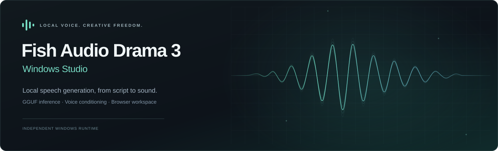
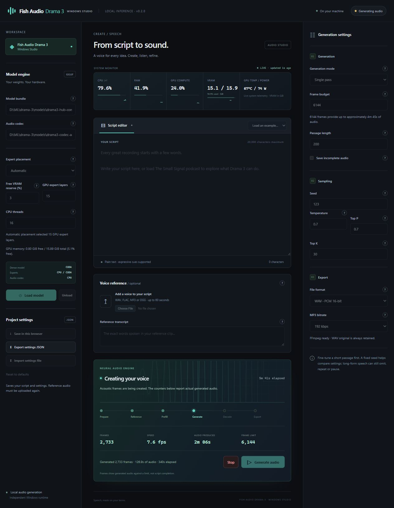
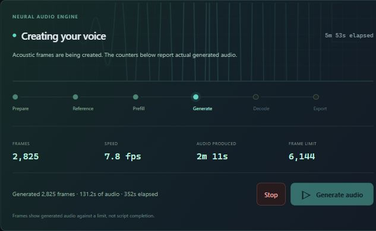
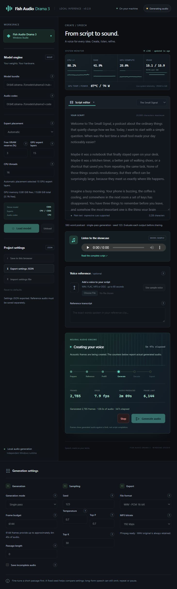

# Give your words a voice. On your own hardware.

**Expressive speech, voice cloning and full-script narration in a local Windows studio.** Load Drama 3 once, shape the performance, listen and export your recording with the settings that made it.

[**Get Windows Studio 0.2.0**](https://github.com/Eng-Ahmd/drama-3-windows/releases/latest) · [**Download the model**](https://huggingface.co/Eng-Ahmd/Drama-3-Windows-GGUF) · [**Installation**](docs/public/INSTALL.md) · [**Studio guide**](docs/public/WEB_UI.md)



*The actual Windows Studio during generation. Live hardware readings and stage counters reflect this capture, rather than benchmark targets.*

## A speech studio built around your workflow

- **Write, clone, perform.** Use your own script and voice reference, with speaker tags and expressive cues supported by Drama 3.
- **Generate a complete script in one pass.** Single-pass generation is the default; audio-history-conditioned text chunks remain optional.
- **Make the most of available memory.** Automatic CPU/CUDA expert placement fits whole banks around the loaded model and caches, with a configurable free-VRAM reserve. Manual placement is available too.
- **See what is happening.** Live operation stages, generation speed and actual CPU, RAM and GPU readings show progress and resource use.
- **Keep the result and the recipe.** Play audio, download WAV or MP3, export project settings before generating, and import settings for another run. Inline help explains each control.

<details>
<summary><strong>See the generation monitor and loaded podcast</strong></summary>



The monitor follows preparation, reference encoding, prefill, acoustic generation, decoding and export. Frame counts measure generated audio; they do not estimate how much script remains.



</details>

## Hear a complete podcast

https://github.com/user-attachments/assets/a59179be-b1dc-45d2-b049-f5105606cf0a

*Play here without leaving GitHub. Enable sound in the player if it starts muted. The video pairs the original narration with static artwork; WAV and MP3 downloads remain below.*

[**The Small Signal · 3:16**](https://huggingface.co/Eng-Ahmd/Drama-3-Windows-GGUF#podcast--the-small-signal) is an original 592-word narration generated in **one request, without text chunks, retries or speech edits**. Load the included sample in the studio to try it yourself.

[**Listen / download MP3**](https://huggingface.co/Eng-Ahmd/Drama-3-Windows-GGUF/resolve/main/demos/podcast-small-signal.mp3) · [**Lossless WAV**](https://huggingface.co/Eng-Ahmd/Drama-3-Windows-GGUF/resolve/main/demos/podcast-small-signal.wav) · [Full script](examples/samples/podcast.txt) · [Importable settings and provenance](https://huggingface.co/Eng-Ahmd/Drama-3-Windows-GGUF/resolve/main/demos/podcast-small-signal-settings.json)

The untouched recording completed at 4216 frames and measured **0.34% ASR word error rate** (2 edits / 592 words), with no clipped samples. This is one checked example; automated transcription does not replace listening or establish general long-form quality.

### More ways to shape a voice

- [**Expressive tags**](https://huggingface.co/Eng-Ahmd/Drama-3-Windows-GGUF/resolve/main/demos/point-tags.wav) — spoken dialogue with sighs and laughter.
- [**Contextual edit**](https://huggingface.co/Eng-Ahmd/Drama-3-Windows-GGUF/resolve/main/demos/contextual-edit.wav) — revise Wednesday to Thursday using the earlier take as context.
- [**Chained edit**](https://huggingface.co/Eng-Ahmd/Drama-3-Windows-GGUF/resolve/main/demos/chained-edit.wav) — revise the deadline again while retaining earlier acoustic history.

[Compare these recordings with the original Fish Audio demos](https://huggingface.co/Eng-Ahmd/Drama-3-Windows-GGUF#listen-original-vs-windows).

## Start creating

Follow the [installation guide](docs/public/INSTALL.md) to set up Windows prerequisites, Python, the **matching 0.2.0 native libraries**, and the model and codec bundles. Weights are downloaded separately; MP3 export requires FFmpeg with libmp3lame.

Then launch the studio from your runtime environment:

```powershell
python -m fish_drama3.webui
```

Open [http://127.0.0.1:7860](http://127.0.0.1:7860), select your model and codec paths, and load the model. Choose a sample or enter your text, optionally upload a voice reference with its transcript, and generate. Unload the model when finished to release its memory.

The [studio guide](docs/public/WEB_UI.md) covers controls, project settings, output formats and live vitals. Prefer the terminal? The [user guide](docs/public/USER_GUIDE.md) covers the offline synthesis CLI and guarded runs.

## Inside the runtime

Drama 3 is a **35.9B MoE** speech model. This Windows port combines a PyTorch backbone and audio tower, native GGML CPU/CUDA routed experts, and a native reference encoder/audio decoder. The custom `fish_drama3` GGUF bundle requires this matching runtime.

Expert weights use **Q4_K**, the backbone **Q8_0**, sensitive vectors **F32**, and the audio tower **BF16**. Learned codec weights use F32, with BF16 RoPE tables. The model bundle is about **21.67 GiB**, plus **1.46 GiB** for the codec. The model bundles remain compatible with runtime 0.1.1 or newer; the current studio's automatic placement requires the 0.2.0 Python source and native bridge together.

[Model card](docs/public/MODEL_CARD.md) · [Quality and qualification](docs/public/QUALITY.md) · [Attribution](NOTICE.md)

<details>
<summary><strong>Measurements, memory and current limits</strong></summary>

The podcast run used Windows 11, an RTX 5080 Laptop with 16 GiB VRAM, 128 GiB RAM and eight CPU threads. Automatic placement selected 15 GPU expert layers with a 3% VRAM reserve. Prefill and acoustic generation took **520.00 seconds**; CPU codec decoding added **223.34 seconds**, giving **743.34 seconds synthesis**, excluding model loading (27.26 seconds) and MP3 export. These are one-run measurements, not an aggregate benchmark.

Automatic placement defaults to 3% free VRAM, configurable from 1–25%, after dense weights, request caches and an additional 256 MiB expert-workspace allowance. This governs memory occupancy, not GPU compute utilization. Manual placement supports 0–40 GPU expert layers; its initial value of 16 is a requested count, not a fit guarantee. Continuous monitoring preserves the chosen VRAM reserve and 8 GiB free host RAM.

The studio defaults to 6144 audio frames and supports up to 8192 within a 10,240-row prompt-plus-output limit. Reference audio consumes prompt rows too. A frame budget is not a completion percentage. Generation is stochastic and can omit or repeat words, stop early or pause; inspect each result. Incomplete output is rejected unless partial output is explicitly enabled.

Targeted evidence includes all 850 checked reference codec codes matching, decode relative RMSE 1.74 × 10⁻⁶, four short English checks with zero ASR WER, and one Chinese plain-speech check with zero CER. A guarded two-hour repeated-request soak completed 713 speech requests and 143 validation recovery cycles. These checks do not establish broad acoustic quality, speaker similarity or production qualification. Clean-machine installation and broader coverage remain documented work; see the [quality report](docs/public/QUALITY.md).

</details>

## Built with Fish Audio

Drama 3 materials retain the **Fish Audio Community License v1.0**. The s2.cpp-derived codec and its derivative work are separately governed by the **Fish Audio Research License**, which requires a separate written Fish Audio agreement for commercial use. GGML components retain the MIT license. See [NOTICE.md](NOTICE.md) and the [complete component terms](LICENSES/THIRD_PARTY_NOTICES.md).

This repository does not grant rights to model weights, reference audio or commercial use. Use voice references with the necessary rights and speaker consent, and review all component terms before use or redistribution.
